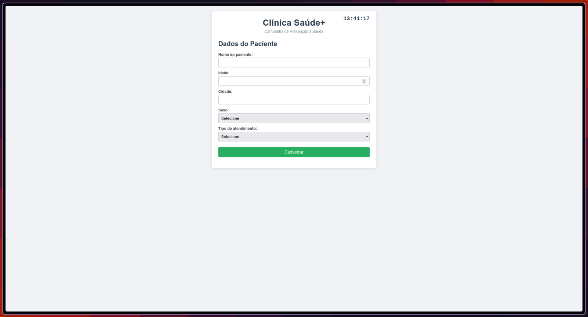
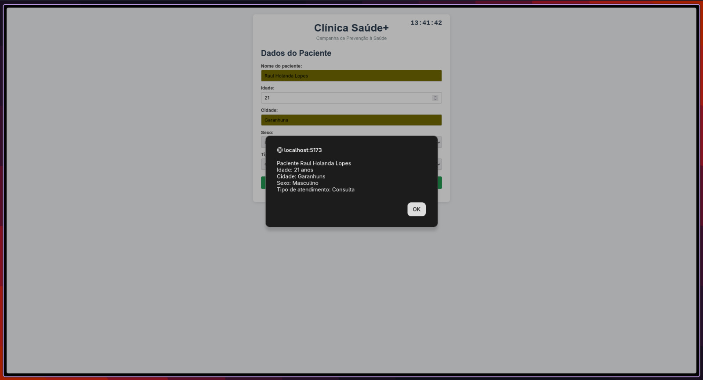

# Cadastro de Pacientes

Aplicação React para cadastro de pacientes em uma campanha de prevenção à saúde.

## Requisitos atendidos

| Requisito | Implementação |
|---|---|
| **1. Componente PacienteForm** | `src/PacienteForm.jsx` — class component com o formulário |
| **2. Único método handleChange** | `handleChange()` único para todos os campos usando `event.target.name` |
| **3. Dados no state** | `this.state = { nome, idade, cidade, sexo, atendimento }` |
| **4. event.preventDefault()** | Chamado no `handleSubmit` |
| **5. Alerta com dados** | `alert()` exibindo todos os campos preenchidos |
| **6. Componente Cabecalho com props** | `src/Cabecalho.jsx` — recebe `nome` via props |
| **7. Componente App principal** | `src/App.jsx` — reúne todos os componentes |

## Desafio Extra (+2 pts)

- **Relógio digital** em `src/Relogio.jsx` — class component que atualiza a hora a cada 1 segundo com `setInterval`.

## Exemplos


*Formulário com os campos preenchidos*


*Alerta exibido após o cadastro*

## Como rodar

```bash
npm install
npm start
```

## Estrutura do projeto

```
src/
├── App.jsx           # Componente principal
├── Cabecalho.jsx     # Cabeçalho com props
├── PacienteForm.jsx  # Formulário controlado
├── Relogio.jsx       # Relógio digital (extra)
├── App.css           # Estilos
├── index.css         # Estilos globais
└── main.jsx          # Entry point
```

## Relatório de desenvolvimento

No geral o projeto foi tranquilo de fazer. A parte de criar os componentes com class components e gerenciar state com `this.setState` já é algo que praticamos bastante em aula. O formulário controlado com `value` e `onChange` também seguiu o padrão que vimos.

O que me deu um pouco mais de trabalho foi a manipulação de múltiplos campos com um único `handleChange`. No começo eu estava fazendo um método para cada campo, mas depois lembrei do truque de usar `event.target.name` como chave dinâmica no `setState` — `this.setState({ [event.target.name]: event.target.value })` — isso simplificou bastante o código.

Outro ponto foi garantir que os selects começassem com uma opção vazia desabilitada (`<option value="" disabled>Selecione</option>`) para forçar o usuário a escolher, já que os campos são obrigatórios. Nada complicado, mas é um detalhe que faz diferença na usabilidade.

A lógica de submissão com `preventDefault` e a exibição do alerta foi bem direta. O componente `Cabecalho` recebendo o nome da clínica via props também seguiu exatamente o que vimos em sala.

Já o relógio digital do desafio extra foi interessante de implementar. Usei `setInterval` no `componentDidMount` para atualizar o state a cada segundo e limpei o timer no `componentWillUnmount` para evitar vazamento de memória. O `toLocaleTimeString('pt-BR')` já formata a hora no padrão brasileiro.

No fim, deu pra aplicar tudo que vimos na matéria sem grandes surpresas.
